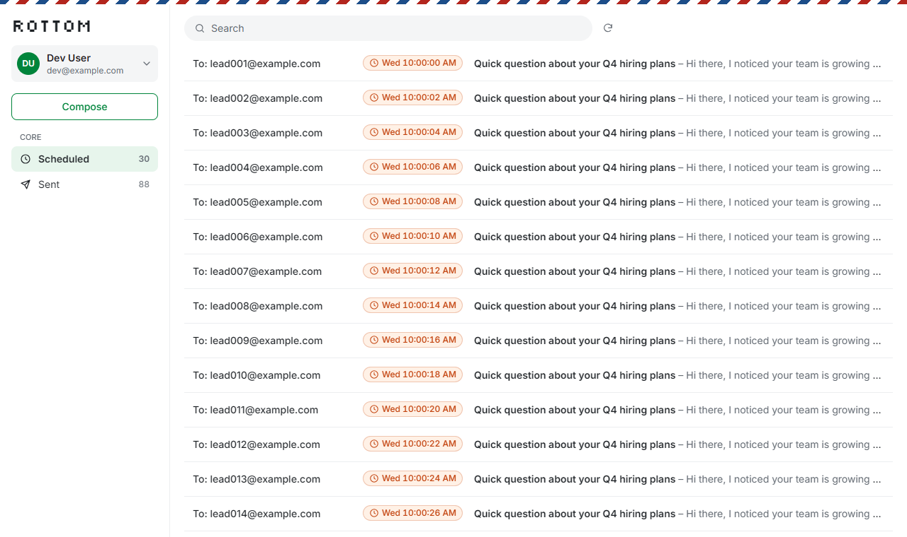
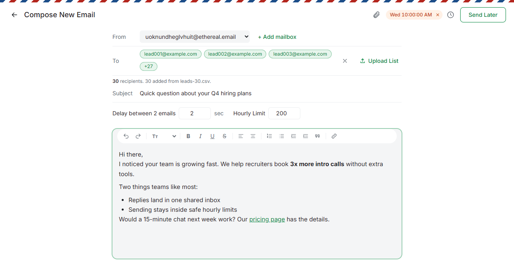
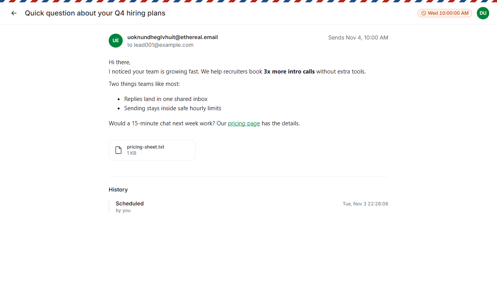
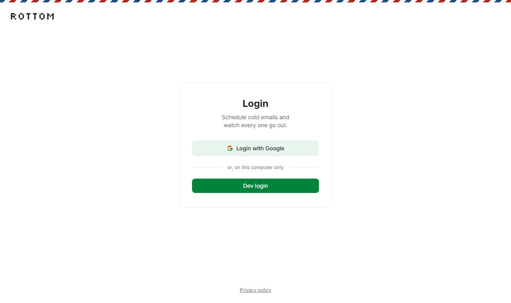
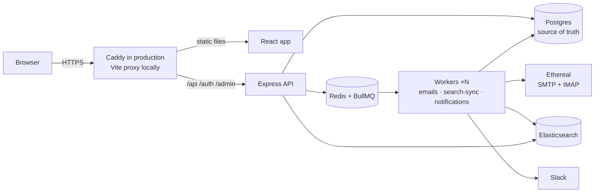

# rottom-mail

**Schedule cold-email campaigns that go out on time, exactly once, and within safe sending limits.**
Built for the ReachInbox hiring assignment: a full-stack email job scheduler with a Gmail-style dashboard.

**[Live demo](https://rottom.outbox.shikharsaxena.space)** · **Demo video:** _link to be added_ · **[Design docs](./docs/README.md)**



## What it does

- **Log in with Google.** Your name, email and photo sit in the sidebar. Logout really ends the session.
- **Compose a campaign:**
  - Upload a CSV, or type addresses.
  - Write a formatted message: bold, links, lists.
  - Attach up to 3 files.
  - Choose the start time ("Send Later"), the delay between emails and an hourly limit.
- **Watch it go out.** The **Scheduled** tab shows every email with its send time, and the **Sent** tab fills live. Each email has its own page with the message, an Ethereal preview link and its full history.
- **Search every email.** Recipients, subjects and message text, powered by Elasticsearch.
- **Get a Slack alert** when a sending limit is reached, in the channel you choose.
- **Retry safely.** A failed email, or one whose outcome is unknown after a crash ("Needs check"), can be sent again. The app first checks the mailbox, so a copy that already went out is never sent twice.

| Compose | Email page | Login |
|---|---|---|
|  |  |  |

The UI follows the given Figma, with two touches of its own: a pixel **ROTTOM** wordmark and an airmail edge ([why](./docs/02-design-decisions.md#d27--ui-the-figma-plus-our-own-touch-)). Every email goes to **Ethereal**, a fake SMTP service: messages can be previewed but never reach a real inbox.

## What makes it reliable

| Guarantee | How |
|---|---|
| **No cron** | Each email is a row in Postgres plus a BullMQ **delayed job**. The ESLint rules fail the build if cron code appears. |
| **Survives restarts** | Redis keeps jobs on disk (AOF, `noeviction`). On startup the API re-adds any job Redis lost, from Postgres. Overdue emails go out right away. |
| **Never sends twice** | Job id = email id, so an email can't be queued twice. Before sending, a worker claims the email in one atomic database update (`scheduled → sending`), so two workers can't both send it. After a crash, the worker searches the sender's mailbox for the email's fixed Message-ID before trying again. |
| **Rate limits that hold across many workers** | **Per sender:** each mailbox has its own hourly cap (one atomic Redis script). **Global:** one cap for everything, and the queue pauses. Extra emails are **delayed to the next window in order, never dropped**. At least 2 s between sends. |
| **Concurrency** | `WORKER_CONCURRENCY` jobs per worker, and as many workers as you like (`--scale worker=2` in production). The atomic claim keeps it safe. |
| **A history you can trust** | Every change is written in the same transaction as an append-only audit event. A database trigger blocks edits and deletes. |
| **Security** | Google login with PKCE, sessions in Redis, Slack and SMTP secrets encrypted (AES-256-GCM). One origin, so no CORS, plus an `Origin` check. Users see only their own data, and the queue dashboard is for admins only. |

## Architecture



**The life of one email:**
1. **Schedule:** `POST /api/campaigns` checks the form and saves one row per lead in a single transaction, then adds one delayed job per row.
2. **Wait:** the job sleeps in Redis until its send time. Restarts don't matter.
3. **Rate limit:** at its time, a worker asks the limiter for a slot. If the hour is full, the email moves to the next window, keeping its place in line, and Slack gets one alert.
4. **Claim and send:** the worker claims the row (`scheduled → sending`) and sends it through the sender's Ethereal mailbox with a fixed Message-ID.
5. **Record:** the row becomes `sent`, with the SMTP reply and a preview link. An audit event is written in the same transaction, and a sync job copies the change to Elasticsearch.
6. **If something goes wrong:** a temporary SMTP error (4xx) moves it to the next window, and a permanent one (5xx) marks it `failed`. No reply, or a crash, leads to a mailbox check, and the email becomes "Needs check" only when the app can't tell.

More detail: [architecture](./docs/01-architecture.md) · [scheduling & restarts](./docs/03-scheduling-persistence.md) · [rate limiting](./docs/04-rate-limiting.md) · [all decisions](./docs/02-design-decisions.md)

## Requirements checklist

| Requirement | How | Docs | Status |
|---|---|---|---|
| Accept scheduling requests via an API | `POST /api/campaigns`, checked with zod | [01](./docs/01-architecture.md#api) | ✅ |
| Store in a relational database | Postgres + Prisma, one row per recipient | [01](./docs/01-architecture.md#data-model-prisma-planned) | ✅ |
| BullMQ delayed jobs, no cron | `delay` + `jobId`; the build fails on cron code | [03](./docs/03-scheduling-persistence.md#no-cron) | ✅ |
| Multiple senders via Ethereal | 2 mailboxes created per user, "+ Add mailbox" up to 5, pooled SMTP | [08](./docs/08-senders-ethereal.md) | ✅ |
| Survive restarts without losing or repeating emails | AOF + startup repair + job id + atomic claim + mailbox check | [03](./docs/03-scheduling-persistence.md) | ✅ |
| Hourly limits in Redis, safe across workers, delayed not dropped | Lua slot per sender / global counter + queue pause | [04](./docs/04-rate-limiting.md) | ✅ |
| Minimum delay between sends | `MIN_DELAY_BETWEEN_SENDS_MS=2000` | [04](./docs/04-rate-limiting.md) | ✅ |
| Configurable worker concurrency | `WORKER_CONCURRENCY`, scalable workers | [09](./docs/09-scaling-impacts.md) | ✅ |
| Slack alert when a limit is reached | Real Slack OAuth (`incoming-webhook`), `notifications` queue | [06](./docs/06-auth-slack.md#slack-connect) | ✅ |
| Searchable via Elasticsearch | `search-sync` queue; ES finds the ids, Postgres shows the rows | [05](./docs/05-search-elasticsearch.md) | ✅ |
| Live BullMQ dashboard | Bull Board at `/admin/queues` (read-only, admins only) | [07](./docs/07-audit-observability.md#bull-board) | ✅ |
| Google login, profile in the header, logout | Backend OAuth (state + PKCE), Redis sessions | [06](./docs/06-auth-slack.md#google-login) | ✅ |
| Dashboard with Scheduled / Sent tabs | Figma layout, live counts, loading and empty states | [02 D27](./docs/02-design-decisions.md#d27--ui-the-figma-plus-our-own-touch-) | ✅ |
| Compose: subject, body, CSV with a count, start time, delay, hourly limit | Recipient chips, "Send Later", formatting toolbar, attachments | [02 D28](./docs/02-design-decisions.md#d28--formatted-messages-and-attachments-) | ✅ |
| Behaviour with 1000+ emails | Designed for it (book a slot and step aside, overflow by window); the `SMTP_MODE=fake` load test hasn't been run yet | [09](./docs/09-scaling-impacts.md) | 🟡 |

**Beyond the brief:**
- **Delivery:** a mailbox check before any resend (no duplicate after a crash), and two rate-limit modes to compare.
- **Message:** formatted emails with attachments.
- **History:** an append-only audit trail with a history per email.
- **Operations:** structured logs, a per-user cap on waiting emails, a privacy page.
- **Deployment:** live on AWS with automatic HTTPS.

## Chosen delay and limits

- **At least 2 seconds between sends** (`MIN_DELAY_BETWEEN_SENDS_MS=2000`): per sender in per-sender mode, across all senders in global mode.
- **200 emails per hour** (`MAX_EMAILS_PER_HOUR_PER_SENDER` / `MAX_EMAILS_PER_HOUR`). Keep the per-sender value at 200 or below, because Ethereal itself rejects more than 200 an hour from one account.
- **When the limit is reached,** extra emails move to the next window in arrival order, and are never failed or dropped. Slack gets one message per window. Trade-offs: [docs/04](./docs/04-rate-limiting.md#side-by-side).

## Run it locally

**You need:** Node 20+ and Docker. [`mkcert`](https://github.com/FiloSottile/mkcert) is only needed for connecting Slack, which requires HTTPS redirect links.

```bash
mkcert -install && mkcert localhost      # optional: HTTPS for Vite (localhost.pem files in the repo root, git-ignored)
docker compose up -d                     # Postgres :5432, Redis :6380, Elasticsearch :9200

cd backend
cp .env.example .env                     # set ENCRYPTION_KEY (openssl rand -base64 32); Google/Slack keys or DEV_LOGIN=true
npm install
npx prisma migrate dev
npm run dev:api                          # API on :4000 (private; the browser reaches it through Vite)
npm run dev:worker                       # the workers: emails, search-sync, notifications

cd ../frontend
npm install
npm run dev                              # https://localhost:5173 (http:// without mkcert: then set APP_URL to http in backend/.env)
```

Then open `https://localhost:5173`, log in, and upload one of the [sample lead lists](./samples): 15, 30, 100 or 200 made-up `example.com` addresses.

**Demo mode (no `.env` edits):** 1-minute windows and a cap of 5, so the rate limiter shows up in minutes, not hours.

```bash
npm run demo:api             # instead of dev:api; Compose then reads "Limit per minute"
npm run demo:worker          # per-sender mode: 5 per minute per sender
npm run demo:worker:global   # global mode: 5 per minute across all senders
```

To switch modes, stop the worker (Ctrl+C) and start the other command. In Compose, set the limit above 5, or the campaign spaces itself out and the server cap never has to act.

<details>
<summary><b>All settings</b> (<code>backend/.env</code>)</summary>

| Variable | Default / example | What it does |
|---|---|---|
| `DATABASE_URL` / `REDIS_URL` / `ELASTICSEARCH_URL` | local Docker addresses | Infrastructure |
| `APP_URL` | `https://localhost:5173` (production: `https://rottom.outbox.shikharsaxena.space`) | The one public address: redirects, Google callback, `Origin` check, cookie flags |
| `GOOGLE_CLIENT_ID` / `GOOGLE_CLIENT_SECRET` | | Google login |
| `SLACK_CLIENT_ID` / `SLACK_CLIENT_SECRET` | | Slack connect |
| `SLACK_REDIRECT_URI` | `https://localhost:5173/api/slack/callback` | Must match a URL registered in the Slack app |
| `ENCRYPTION_KEY` | 32 random bytes, base64 | Encrypts webhook URLs, tokens and SMTP passwords |
| `RATE_LIMIT_MODE` | `per_sender` | or `global` |
| `MAX_EMAILS_PER_HOUR_PER_SENDER` / `MAX_EMAILS_PER_HOUR` | `200` | The hourly caps |
| `MIN_DELAY_BETWEEN_SENDS_MS` | `2000` | Minimum gap between sends |
| `RATE_LIMIT_WINDOW_MS` | `3600000` | `60000` in demo mode |
| `WORKER_CONCURRENCY` | `5` | Parallel jobs per worker |
| `WORKER_QUEUES` | `emails,search-sync,notifications` | Which queues this worker process runs |
| `SMTP_MODE` | `ethereal` | `fake` for load tests (nothing is sent) |
| `DEV_LOGIN` | `false` | `true` adds a "Dev login" button, but only when `APP_URL` is localhost, and never in production |
| `DEFAULT_SENDERS_PER_USER` / `MAX_SENDERS_PER_USER` | `2` / `5` | Ethereal mailboxes per user |
| `ADMIN_EMAILS` | empty | Google emails allowed to open the queue dashboard (it shows every user's jobs) |
| `MAX_PENDING_EMAILS_PER_USER` | `20000` | How many emails one user may have waiting; a bigger campaign is refused (429) |

</details>

<details>
<summary><b>Google, Slack and Ethereal setup</b></summary>

- **Google:** a Web OAuth client with the redirect `https://localhost:5173/auth/google/callback`, plus `https://rottom.outbox.shikharsaxena.space/auth/google/callback` for production. Testing mode, with test users added.
- **Slack:** an app with Incoming Webhooks turned on, scope `incoming-webhook`, and the redirects `https://localhost:5173/api/slack/callback` and `https://rottom.outbox.shikharsaxena.space/api/slack/callback`. For other workspaces to connect, activate public distribution. To try alerts without the Slack app, run `npm run dev:slack-webhook <webhook URL>`.
- **Ethereal:** nothing to set up. The first time a user opens Compose, the backend creates 2 Ethereal mailboxes for them, and "+ Add mailbox" creates more. Ethereal keeps messages for a few hours.

Step by step: [docs/06](./docs/06-auth-slack.md) · [docs/08](./docs/08-senders-ethereal.md)

</details>

## Tests

```bash
cd backend && npm test     # 37 tests; the integration tests need `docker compose up -d`
cd frontend && npm test    # 6 tests
```

**What they cover:**
- **Sending once:** each email goes out once, even with two workers racing or the same form submitted twice.
- **Crashes and retries:** crash recovery and the mailbox check, Retry send, and the startup repair.
- **Rate limits:** the limiter's spacing, order, overflow and global pause.
- **Login and access:** the OAuth `state` checks, and that one user can't see or touch another's emails.
- **Search and Slack:** Elasticsearch search, and Slack's error handling.
- **Smaller pieces:** attachments, the per-user cap, encryption, the log helper, and the frontend's address parser, Send Later times and link checks.

Several tests were checked by breaking the code they protect and confirming they fail ([docs/12](./docs/12-backend-fixes.md)).

## Deployment

Live at **<https://rottom.outbox.shikharsaxena.space>**. It runs on one AWS EC2 server in Mumbai, with [`docker-compose.prod.yml`](./docker-compose.prod.yml):
- **What runs:** Postgres, Redis, Elasticsearch, a one-off migration step, the API, two workers, and Caddy.
- **HTTPS:** Caddy gets and renews a Let's Encrypt certificate by itself.
- **Exposure:** only ports 80 and 443 are public.

```bash
docker compose -f docker-compose.prod.yml up -d --build --scale worker=2
```

Steps, security group and lessons from the first deploy: [docs/11](./docs/11-deployment-aws.md).

## Project layout

```
backend/
  src/routes/         auth, campaigns, emails, senders, slack
  src/services/       scheduling, rate limiter, mailer + mailbox check, search, sessions, Slack
  src/workers/        emails, search-sync, notifications
  src/lib/            Prisma, Redis, BullMQ queues, logger
  prisma/             schema + migrations (including the audit trigger)
  tests/              unit + integration
  demo/               1-minute demo limits
frontend/
  src/pages/          Login, Dashboard, Compose, EmailView, Privacy
  src/components/     Sidebar, EmailList, Editor, History, UI kit
  Caddyfile           production web server (one origin)
samples/              lead lists to upload
docs/                 design, decisions, deployment, fixes
```

## Assumptions and trade-offs

- **Ethereal only:** nothing reaches real inboxes. Messages expire after a few hours, but the audit log keeps the SMTP reply as proof.
- **One "From" sender per campaign.** Every lead gets the same subject and message (no personalization).
- **At most once, plus a mailbox check:** a duplicate cold email is worse than a missed one. When the app can't tell whether an email went out, it shows "Needs check" with Retry.
- **Hourly windows follow the clock (UTC).** A send counts against the hour in which its slot was booked, so a later failure still counts. This errs on the safe side.
- **If Redis loses data,** the current window's counters can reset, so a few extra sends are possible. Jobs are rebuilt from Postgres.
- **Search lags about 1 second.** The tabs read Postgres, so statuses are always exact.
- **Global mode** pauses the whole queue for everyone. That's why per-sender is the default.
- **No automatic cleanup** of old audit events or jobs, beyond BullMQ's age limits (no cron).
- **One origin:** Caddy (production) and the Vite proxy (local) forward `/api`, `/auth` and `/admin` to a private API, so there's no CORS and no public API address.
- **Skipped on purpose:** a hash-chained audit log, rotating between senders, per-sender limit settings, "limit cleared" Slack messages, and sending through users' own Gmail.

All decisions with their alternatives: [docs/02](./docs/02-design-decisions.md). Sources and research notes: [docs/references.md](./docs/references.md).

## Documentation

| Doc | What's inside |
|---|---|
| [01 · Architecture](./docs/01-architecture.md) | Components, data model, API, end-to-end flow |
| [02 · Design decisions](./docs/02-design-decisions.md) | Every decision (D1–D28) with options and reasons |
| [03 · Scheduling & persistence](./docs/03-scheduling-persistence.md) | Delayed jobs, restarts, at-most-once delivery |
| [04 · Rate limiting](./docs/04-rate-limiting.md) | Per-sender vs global, side by side |
| [05 · Search](./docs/05-search-elasticsearch.md) | Elasticsearch sync and queries |
| [06 · Auth & Slack](./docs/06-auth-slack.md) | Google login, sessions, Slack connect, security checklist |
| [07 · Audit & observability](./docs/07-audit-observability.md) | Audit trail, Bull Board, logs |
| [08 · Senders & Ethereal](./docs/08-senders-ethereal.md) | Mailboxes, limits, delivery facts |
| [09 · Scaling](./docs/09-scaling-impacts.md) | What changes at higher load |
| [11 · Deployment](./docs/11-deployment-aws.md) | AWS EC2 + Docker Compose + Caddy |
| [12 · Backend fixes](./docs/12-backend-fixes.md) | Every bug found and how it was fixed |
