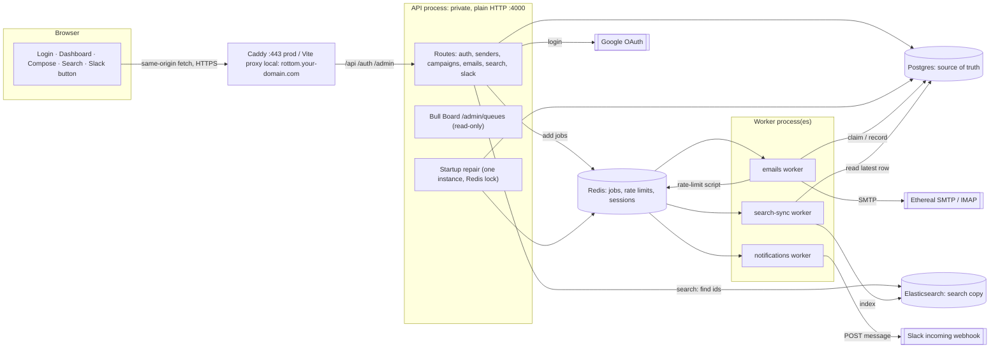
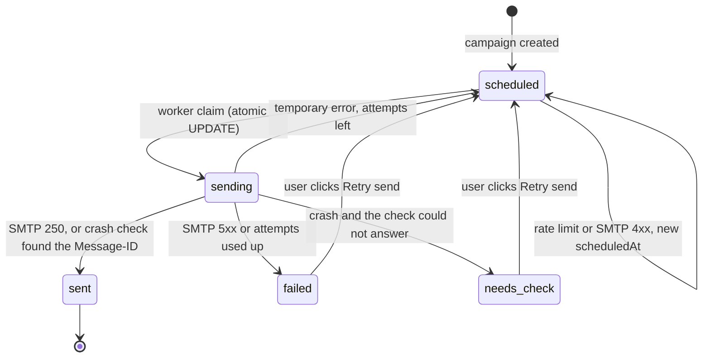

# 01 · Architecture

The system schedules and sends emails at scale. Users schedule emails through an API, the emails are stored in Postgres, BullMQ delayed jobs in Redis fire them at the right time, and they go out through Ethereal (fake SMTP). The system survives restarts, enforces rate limits safely across many workers, and shows everything in a React dashboard.

**Core idea:** Postgres holds the truth, with one row per recipient email. BullMQ delayed jobs (`jobId = email.id`) handle timing. Redis holds the rate-limit state and the sessions. Elasticsearch is a search copy rebuilt from Postgres.

---

## Components

| Component | Tech | Role |
|---|---|---|
| Frontend | Vite + React + TypeScript + Tailwind + React Router + TanStack Query + `sonner` toasts | Login, dashboard (Scheduled / Sent tabs), compose, search, Slack connect. Served at `rottom.your-domain.com` |
| Front door | Caddy (prod, automatic HTTPS) / Vite dev proxy (local, mkcert) | One origin. `/api`, `/auth`, `/admin` go to the API, everything else to the frontend |
| API | Express 5 + TypeScript + `zod` | Auth, campaigns, emails, search, senders, Slack, Bull Board. **Private**, plain HTTP `:4000`, only reached through the front door |
| Workers | BullMQ workers (separate process from the API) | `emails` (send), `search-sync` (copy to ES), `notifications` (Slack) |
| Database | Postgres + Prisma | Source of truth: users, senders, campaigns, emails, Slack integrations, audit events |
| Queue / coordination | Redis (AOF on, `noeviction`) | BullMQ jobs, rate-limit counters and slots, sessions, OAuth `state`, locks |
| Search | Elasticsearch 8 (single node) | Full-text search over emails |
| SMTP | Ethereal via `nodemailer` | Fake SMTP: catches every message, delivers nothing. IMAP is used for the crash check |
| Queue UI | `@bull-board/express` at `/admin/queues` | Live view of the queues, read-only, behind login |
| Login | Google OAuth (`google-auth-library`) | Real login. Name, email and avatar in the header |
| Alerts | Slack OAuth v2 (`incoming-webhook`) | Live message when an hourly limit is reached |

---

## Processes



The API and the workers are **separate entry points**. Workers can be killed, restarted or scaled on their own (`WORKER_QUEUES=emails,search-sync,notifications`), which is what the restart demo shows.

## Queues

| Queue | Added by | Job data | Retries | Notes |
|---|---|---|---|---|
| `emails` | API (schedule, Retry send), startup repair | `{ emailId, slot? }` | 3, exponential backoff from 5s | `jobId = email.id` (retry jobs use `<id>-retry-<n>`). Delayed until `scheduledAt` |
| `search-sync` | `updateEmail()` after every commit; bulk job per campaign | `{ emailId }` or `{ campaignId }` | backoff, then the `failed` set | Reads the **latest** row, so order and duplicates don't matter (version check) |
| `notifications` | email worker when a limit is reached; Slack connect | `{ userId, kind, ... }` | backoff on 429/5xx | Slow Slack never holds up sending |

Job data is only IDs. The email body stays in Postgres, so Redis stays small even with millions of delayed jobs.

---

## Data model (Prisma, planned)

```prisma
model User {
  id        String   @id @default(uuid())
  googleId  String   @unique           // Google `sub`, stable even if the email changes
  email     String
  name      String
  avatarUrl String?
  createdAt DateTime @default(now())
}

model Sender {                          // a "From" mailbox (Ethereal account), owned by one user
  id          String       @id @default(uuid())
  userId      String
  email       String       @unique
  smtpUser    String
  smtpPassEnc String                    // AES-256-GCM, key in ENCRYPTION_KEY
  smtpHost    String
  smtpPort    Int
  imapHost    String
  imapPort    Int
  status      SenderStatus @default(active)   // active | broken
  createdAt   DateTime     @default(now())
  @@index([userId, status])
}

model Campaign {
  id          String   @id @default(uuid())
  userId      String
  senderId    String
  subject     String
  body        String                    // same for every lead (no personalization)
  startAt     DateTime
  delayMs     Int
  hourlyLimit Int
  createdAt   DateTime @default(now())
}

model Email {                           // one row per recipient
  id             String      @id @default(uuid())   // = BullMQ jobId
  campaignId     String
  userId         String
  senderId       String
  toEmail        String
  scheduledAt    DateTime
  status         EmailStatus @default(scheduled)    // scheduled | sending | sent | failed | needs_check
  attempts       Int         @default(0)
  claimedAt      DateTime?
  sentAt         DateTime?
  messageId      String?                            // fixed: <email.id@reachinbox.local>
  previewUrl     String?                            // Ethereal preview (expires after a few hours)
  error          String?
  version        Int         @default(1)            // +1 on every change (ES ordering)
  indexedVersion Int         @default(0)            // last version written to ES
  createdAt      DateTime    @default(now())
  updatedAt      DateTime    @updatedAt
  @@unique([campaignId, toEmail])
  @@index([userId, status, scheduledAt])
  @@index([senderId, status, scheduledAt])
}

model SlackIntegration {
  userId         String   @id
  teamId         String
  teamName       String
  channel        String
  channelId      String
  webhookUrlEnc  String                // the webhook URL is a secret (Slack docs), so it's encrypted
  accessTokenEnc String
  status         SlackStatus @default(active)      // active | broken
  lastError      String?
  connectedAt    DateTime @default(now())
}

model AuditEvent {                      // append-only (DB trigger blocks UPDATE/DELETE)
  id         BigInt   @id @default(autoincrement())
  userId     String
  campaignId String?
  emailId    String?
  type       String
  fromStatus String?
  toStatus   String?
  actor      String                     // user:<id> | worker:<host>:<pid> | system:startup-repair
  attempt    Int?
  data       Json
  createdAt  DateTime @default(now())
  @@index([emailId, createdAt])
  @@index([campaignId, createdAt])
  @@index([userId, createdAt])
}
```

### Email status lifecycle



Dashboard tabs: **Scheduled** shows `scheduled` and `sending`. **Sent** shows `sent`, `failed` and `needs_check` (amber "Needs check" badge).

---

## API

| Method | Path | Auth | Purpose |
|---|---|---|---|
| GET | `/auth/google` | none | Start Google login (state + PKCE) |
| GET | `/auth/google/callback` | none | Finish login, create session, redirect to `/dashboard` |
| POST | `/auth/logout` | session | Delete session |
| GET | `/api/me` | session | Name, email, avatar for the header |
| GET | `/api/senders` | session | List the user's senders. Creates 2 Ethereal mailboxes if they have none ([08](./08-senders-ethereal.md)) |
| POST | `/api/senders` | session | "Add sender" (cap 5 per user) |
| POST | `/api/campaigns` | session | Schedule: `{ campaignId, senderId, subject, body, leads[], startAt, delayMs, hourlyLimit }`. The form makes `campaignId` once, so submitting it twice creates one campaign |
| GET | `/api/emails?tab=scheduled\|sent&cursor=` | session | Tabs, read from **Postgres**, cursor pagination |
| GET | `/api/emails/search?q=&status=` | session | **ES finds the IDs, Postgres shows the rows** ([05](./05-search-elasticsearch.md)) |
| GET | `/api/emails/:id/events` | session | Audit timeline for one email |
| POST | `/api/emails/:id/retry` | session | Retry send for `needs_check` / `failed` (new job ID, audited) |
| GET | `/api/slack` | session | `{ status, team, channel }` (never the webhook URL) |
| GET | `/api/slack/connect` | session | Start Slack OAuth |
| GET | `/api/slack/callback` | session | Finish Slack OAuth |
| DELETE | `/api/slack` | session | Disconnect |
| GET | `/admin/queues` | session | Bull Board (read-only) |

Every state-changing request (POST/PUT/DELETE) must carry `Origin: APP_URL` and JSON content ([06](./06-auth-slack.md#security-checklist)).

---

## End-to-end flow (Gmail login → email sent)

```
① LOGIN     Browser → api/auth/google → Google → callback → User row + Redis session → /dashboard
            (Google tells us only who the user is: name, email, avatar. No permission to send mail.)

② COMPOSE   From: [kaden.wolf41@ethereal.email ▾] (the user's own Ethereal senders)
            Subject, Body, upload leads.csv → "128 emails detected" (parsed in the browser)
            Start 15:00 · Delay 2s · Hourly limit 50 → [Schedule]

③ SCHEDULE  POST /api/campaigns → zod validation
            ONE transaction: Campaign + 128 Email rows (scheduled, planned times) + 128 audit "scheduled"
            after commit: addBulk 128 delayed jobs (jobId = email.id) + 1 search-sync bulk job

④ WAIT      Jobs sit in Redis as "delayed". Nothing runs. Survives restarts.

⑤ DUE       Any free worker takes the job → row not "scheduled"? stop
            Rate limiter (Redis) → hour full: move to next window (+ Slack once)
                                 → slot is later: move job to its slot, worker freed
                                 → slot is now: continue
            Claim: UPDATE … SET status='sending' WHERE id=? AND status='scheduled' (one winner)

⑥ SEND      Pooled nodemailer transporter for that sender → Ethereal SMTP
            Message-ID: <email.id@reachinbox.local> → "250 Accepted" (caught, not delivered)

⑦ RECORD    ONE transaction: status sent, sentAt, messageId, previewUrl + audit "sent" (SMTP reply)
            → search-sync job → ES. Errors: 4xx → next window; 5xx / 8 failures → failed; no SMTP reply → needs_check

⑧ SEE IT    Sent tab (Postgres), history timeline, Ethereal preview link
```

---

## Planned folder layout

```
docker-compose.yml          postgres, redis (AOF + noeviction), elasticsearch
docker-compose.prod.yml     + caddy, api, worker (scalable)   (see 11)
Caddyfile                   HTTPS + static frontend + /api /auth /admin → api:4000
backend/
  prisma/schema.prisma
  eslint.config.mjs         no-cron guard (see 03)
  src/app.ts                express app: middleware, routes, Bull Board, error handler
  src/server.ts             API entry: listen, startup repair, ES index, graceful shutdown
  src/config/env.ts         zod-parsed env
  src/lib/                  db (Prisma), redis, queues (BullMQ queues + job types)
  src/middleware/           originCheck, requireAuth
  src/routes/               auth, senders, campaigns, emails (tabs, search, history, retry), slack
  src/services/             emails (updateEmail: audit + version + sync), limiter (both modes), scheduler (enqueue,
                            startup repair), campaigns, senders, session, mailer, slack (messages), search, plan
  src/workers/              index (worker entry, WORKER_QUEUES), emailWorker, notificationsWorker, searchSyncWorker
  src/utils/                crypto (AES-256-GCM), errors (HttpError), helpers (sleep, chunk)
  src/types/express.d.ts    req.userId
  src/scripts/              dev-session, dev-slack-webhook (dev only)
  tests/unit/               crypto, plan (no Docker needed)
  tests/integration/        delivery, limiter, oauth-state, search, slack (need docker compose up)
frontend/
  vite.config.ts            https when the mkcert files exist; proxy /api /auth /admin → :4000 (one origin)
  src/api/                  client.ts (fetch + ApiError), types.ts, hooks.ts (TanStack Query: useMe, useEmails, useSearch...)
  src/components/ui.tsx     Button, Field, StatusBadge, Spinner, EmptyState (dialogs are the native <dialog>)
  src/components/           Header, SlackButton, EmailTable (both tabs + search results), HistoryDialog
  src/lib/                  extractEmails.ts (regex + Set dedupe, CSV and txt), format.ts (times)
  src/pages/                Login, Dashboard, Compose
```
