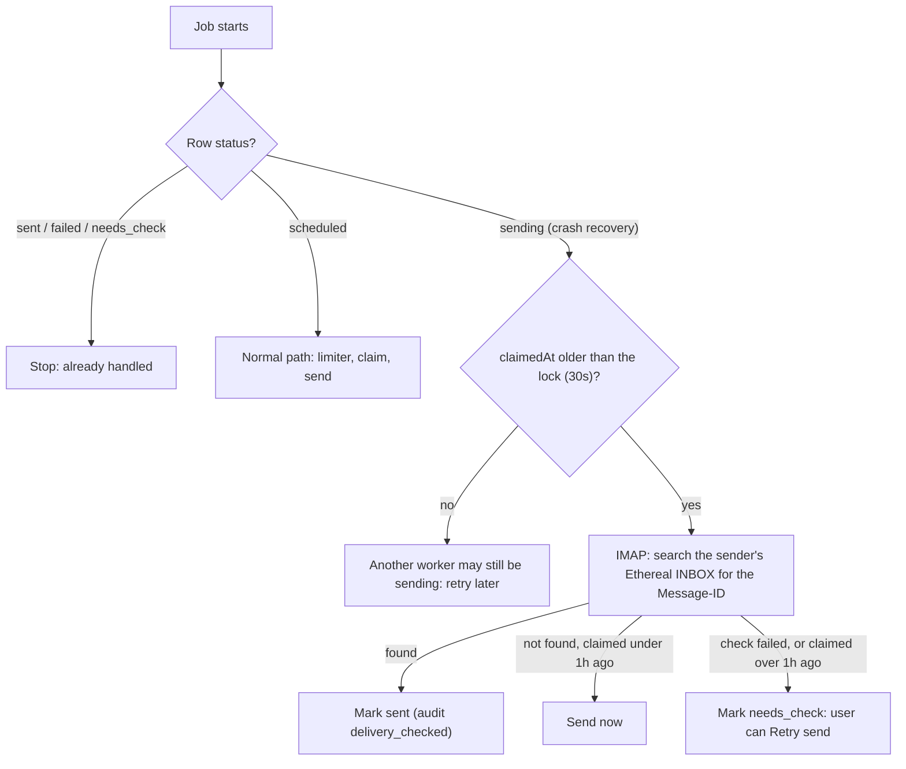

# 03 · Scheduling, persistence and idempotency

How emails get scheduled, why they survive crashes, why none is sent twice, and how "no cron" is enforced.

## Scheduling an email

1. `POST /api/campaigns` validates the input with `zod` (valid emails, sane limits, start time in the future).
2. **One Postgres transaction:** the `Campaign` row, one `Email` row per lead (`status = scheduled`, planned `scheduledAt`), and one audit event `scheduled` per row.
3. **After commit:** `queue.addBulk()` in chunks of 500:
   ```ts
   { name: 'send', data: { emailId }, opts: {
       jobId: email.id,                                  // duplicates are ignored by BullMQ
       delay: scheduledAt - Date.now(),                  // the time lives in Redis, not in Node
       attempts: 8, backoff: { type: 'exponential', delay: 5000 },  // ≈ 10 min: outlasts a short DB restart
       removeOnComplete: { age: 86400, count: 1000 },    // keep recent ones for Bull Board
       removeOnFail: { age: 7 * 86400 },
   } }
   ```
4. One `search-sync` bulk job for the campaign (see [05](./05-search-elasticsearch.md)).

There are **no `setTimeout` timers and nothing scheduled in Node's memory.** A delayed job is a Redis entry that says "run `email-123` at 15:00:00". When a worker starts, it runs whatever is due, including anything that came due while it was down (late, but sent).

## Why it survives crashes: three layers

| Layer | What it holds | How it survives |
|---|---|---|
| **Postgres** | Every email row and its status: the truth | Committed before anything is queued. The write-ahead log makes commits durable |
| **Redis (BullMQ)** | The timers (delayed jobs), rate-limit state, sessions | `appendonly yes`, `appendfsync everysec` (lose at most ~1s), a Docker volume, and `maxmemory-policy noeviction` so Redis never quietly drops job keys (BullMQ requires this) |
| **Startup repair** | Rebuilds Redis from Postgres | On boot, one instance (Redis lock `SET repair_lock NX EX 300`) re-queues every `scheduled` row in batches with the same `jobId` (existing jobs are ignored, missing ones come back, and a job that already gave up on a still-`scheduled` row is replaced) and queues sync for rows where `indexedVersion < version` |

```yaml
# docker-compose.yml (excerpt)
redis:
  image: redis:7
  command: ["redis-server", "--appendonly", "yes", "--appendfsync", "everysec", "--maxmemory-policy", "noeviction"]
  volumes: ["redis-data:/data"]
```

## Why nothing is sent twice

| Guard | What it stops |
|---|---|
| `jobId = email.id` | The same email being queued twice (the API, repair, and retries all use it) |
| `campaignId` made by the Compose form | The same form submitted twice (double-click, resend after an error) creating a second campaign. The insert is `ON CONFLICT DO NOTHING` |
| Status check at job start | Re-processing rows that are already `sent` / `failed` |
| **Atomic claim**: `UPDATE email SET status='sending', claimedAt=now() WHERE id=? AND status='scheduled'` | Two workers sending the same email. Only one gets `count = 1` |
| Option C check (below) | Resending something that actually went out before a crash |
| Repair only re-queues `scheduled` rows | A restart sending again from the beginning. If 400 of 1000 were sent, it continues at 401 |

## Crash scenarios

| What crashes, when | What happens |
|---|---|
| API, while saving a campaign | Transaction rolls back and nothing is half-saved. The user sees an error and retries |
| API, after the DB commit but before queueing | Rows are `scheduled` with no job. Startup repair re-queues them |
| Worker, while emails wait | Nothing is lost (jobs are in Redis). After restart they send on time, or right away if overdue |
| Worker, mid-job before the claim | BullMQ's stalled check (lock expires, ~30s) re-queues it, and it sends normally |
| Worker, after the SMTP send, before marking `sent` | Row is still `sending`. The retry runs the Option C check, finds the Message-ID, marks `sent`. **No duplicate** |
| Worker, after the claim, before the SMTP send | Row is still `sending`. The check finds nothing, so it sends. **Not lost**. If the worker was down for over an hour, "not found" can't be trusted (Ethereal deletes old messages), so the row becomes `needs_check` |
| Redis | AOF loses at most ~1s. Startup repair restores any missing jobs from Postgres. Rate-limit counters for the current window may reset (a few extra sends possible that hour) |
| Postgres | Data is safe. Jobs retry with backoff for about 10 minutes (8 tries). If the outage lasts longer, rows stay `scheduled` and startup repair replaces their dead jobs |
| Whole machine | Both stores are on Docker volumes. Same as above |
| Rate-limited emails | Per-sender: normal delayed jobs, with the new time also stored in the DB. Global: the pause key lives in Redis with a TTL, so the pause survives too |

## Delivery guarantee: at-most-once + Option C

SMTP and Postgres can't be updated atomically together. If a crash lands between "claimed" and "SMTP accepted", nobody knows whether the email went out. We **never resend blindly** (a duplicate cold email is worse than a missed one). Instead:



- Every email is sent with `Message-ID: <email.id@reachinbox.local>` (one line in the nodemailer call).
- The check runs inside BullMQ's own stalled-job retry, so no sweeper is needed.
- **1-hour rule:** Ethereal keeps messages for "a few hours" ([live-tested](./references.md#ethereal)), so "not found" only proves "never sent" when the attempt (`claimedAt`) is under an hour old. "Found" is trusted at any age.
- **"Needs check"** rows show an amber badge. Retry send (`POST /api/emails/:id/retry`) runs the same check first:
  - found: marked `sent`, nothing is sent again (`delivery_checked`)
  - not found, recent: re-queued with a new job ID (`<id>-retry-<n>`), audited as `retry_requested` with the check result
  - can't tell: `409 delivery_unknown`. The UI shows the reason and the risk of a second copy, with a "Send anyway" button (`force: true`)
- **No SMTP reply** parks as `needs_check` without a check, because Ethereal may still be storing the message. The check runs when the user clicks Retry.
- The same approach works in production with Gmail's API (`rfc822msgid:` search) or with delivery webhooks from email services.
- **Remaining risk:** a worker that is frozen but not dead (longer than its lock) could finish sending while the check runs. Rare and documented. If it does, its `sent` result still lands (that write also accepts `needs_check`), so the only gap left is a user clicking Retry send before then.

## Failure handling vs NACK and DLQ

| Concept | RabbitMQ / SQS | BullMQ | Here |
|---|---|---|---|
| Ack | `basic.ack` / `DeleteMessage` | processor returns | row becomes `sent` |
| NACK + requeue | `basic.nack(requeue)` | processor throws, retried with backoff | SMTP 4xx: row back to `scheduled`, retry. No SMTP reply: `needs_check`, never a blind resend |
| Redelivery after the consumer dies | unacked messages requeued / visibility timeout | **stalled job** check | crash mid-send: Option C check |
| DLQ | dead-letter exchange / `maxReceiveCount` | the **`failed` set** (after attempts or `maxStalledCount`) | row `failed`, or `needs_check` for unclear cases |
| "Not now" | delayed requeue / `ChangeMessageVisibility` | `DelayedError` / `RateLimitError` (no attempt used) | rate limit / SMTP 4xx: moved to the next window |

A queue only knows whether the **worker finished**, not whether the **email left**. Option C adds that missing step.

## No cron

| Time-based piece | Trigger | Cron? |
|---|---|---|
| Sending at the scheduled time | BullMQ delayed job | No (the method the assignment allows) |
| Per-sender rate limit | `job.moveToDelayed(slot / next window)` | No |
| Global rate limit | `worker.rateLimit(ms)`: pause key in Redis with a TTL | No |
| Hourly counters reset | Redis key expiry (`PEXPIRE`) | No |
| Startup repair | Runs once when the process boots | No, an event |
| ES sync | A job per DB change | No, an event |
| Crash check (Option C) | BullMQ stalled-job retry | No* |
| "Needs check" for old `sending` rows | Worked out when the dashboard loads (`claimedAt < now() - 5 min`) | No, no sweeper |
| Dashboard refresh every 5s | Browser polling | No, the UI asking for data |

\* BullMQ's stalled check uses a timer **inside the library** (`stalledInterval`, 30s by default). It's part of BullMQ's design, which the assignment requires, and not our code.

**Never used:** `node-cron`, `cron`, `croner`, `node-schedule`, `agenda`, `bree`, OS `crontab`, BullMQ repeatable jobs (`repeat: { pattern }`, `upsertJobScheduler`), or `setInterval` sweepers.

### Enforced by ESLint (`backend/eslint.config.mjs`)

```js
import { defineConfig } from 'eslint/config';
import tseslint from 'typescript-eslint';

// Hard constraint from the assignment: no cron of any kind. The build runs this, so it fails if cron sneaks in.
const NO_CRON = 'No cron: schedule with BullMQ delayed jobs.';

export default defineConfig(tseslint.configs.recommended, {
  files: ['src/**/*.ts'],
  rules: {
    '@typescript-eslint/no-unused-vars': ['error', { argsIgnorePattern: '^_' }],
    'no-restricted-imports': ['error', {
      patterns: [{ group: ['*cron*', 'node-schedule', 'agenda', 'bree'], message: NO_CRON }],
    }],
    'no-restricted-syntax': ['error',
      { selector: "CallExpression[callee.name='setInterval'], CallExpression[callee.property.name='setInterval']", message: NO_CRON },
      { selector: "CallExpression[callee.property.name='upsertJobScheduler']", message: 'BullMQ job schedulers are cron-like.' },
      { selector: "Property[key.name='repeat']", message: 'BullMQ repeatable jobs are cron-like.' },
    ],
  },
});
```

- `"build": "eslint src && tsc"`, so the backend won't build if cron code sneaks in.
- `setTimeout` stays allowed (short waits inside a job; the assignment allows a "custom delay in the worker logic").
- The `repeat` rule flags *any* object key named `repeat` in the backend. That's harmless here, and the message says why.
- **Check:** add `import cron from 'node-cron'` for a moment, confirm `npm run build` fails, then remove it.
