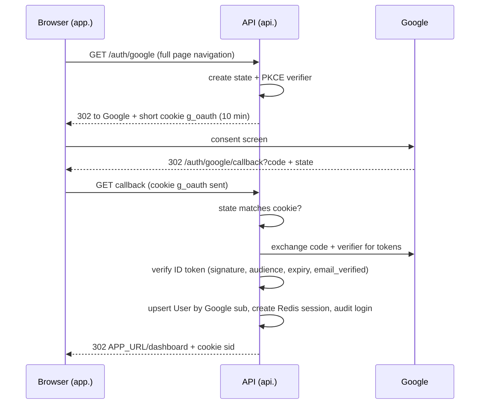
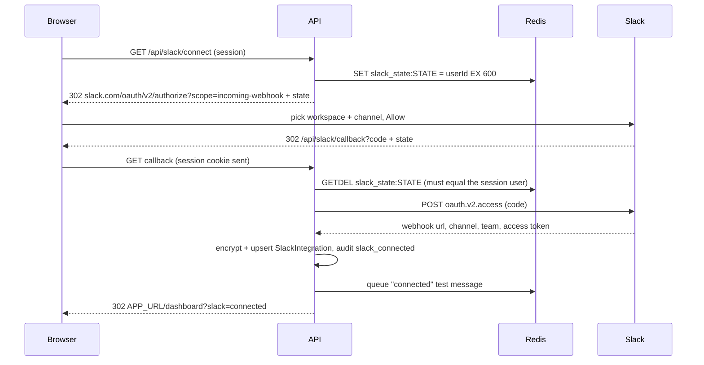

# 06 · Auth (Google) and Slack

## Hosting: setup 2 (subdomains)

| Setup | Example | Login cookie works? | Needs |
|---|---|---|---|
| 1. Proxy (browser sees one domain) | Vercel rewrites `/api` → Render | ✅ | Rewrite rules |
| **2. Subdomains (chosen)** | `app.mysite.com` + `api.mysite.com` | ✅ same site | CORS with credentials + exact origin, `credentials: 'include'` |
| 3. Different sites | `myapp.vercel.app` + `myapi.onrender.com` | ⚠️ third-party cookie: **Safari blocks, Firefox isolates** | Would need a token in a header instead (more code, XSS risk) |

Cookies are grouped by **site** (`mysite.com`), not by full domain. `app.` and `api.` of one domain are the same site. Hosting suffixes like `vercel.app` count as their own top-level suffix, so two `*.vercel.app` apps are different sites.

**Wiring:**
- `app.use(cors({ origin: env.APP_URL, credentials: true }))`. The frontend uses `fetch(\`${VITE_API_URL}/api/...\`, { credentials: 'include' })`.
- Session cookie `sid` is set by `api.mysite.com` with `httpOnly; Secure; SameSite=Lax`. **No `Domain` attribute**, so other subdomains can't read it.
- **Origin check:** POST/PUT/DELETE must have `Origin === APP_URL` and JSON content. `SameSite` treats every `*.mysite.com` as the same site, so a compromised `blog.mysite.com` could otherwise send requests with the cookie.
- **Local dev mirrors production:** `https://localhost:5173` (frontend) and `https://localhost:4000` (API). Different ports means a different origin (CORS is exercised) but the same site (cookies work). Both use HTTPS via `mkcert`, because Slack needs HTTPS redirect URLs and Chrome treats `http` and `https` as different sites. If Slack's settings refuse `localhost`, use a `cloudflared` / `ngrok` tunnel (to confirm).
- Every redirect is built from `APP_URL` / `API_URL` (env), **never from the `Host` header**.

**Why OAuth provider choice doesn't matter for cross-domain:** OAuth (Google or Slack) only answers "who is this?" at login. The app's own session cookie answers "still them?" on every request, and that cookie is what domain setup affects.

## Google login

**Google Cloud Console (once):**
- OAuth client of type "Web application".
- Redirect URIs: `https://localhost:4000/auth/google/callback` and `https://api.mysite.com/auth/google/callback`.
- Consent screen: External, **Testing** mode, with you and the reviewers added as **test users** (only test users can sign in while in testing mode).



```ts
const google = new OAuth2Client(env.GOOGLE_CLIENT_ID, env.GOOGLE_CLIENT_SECRET, `${env.API_URL}/auth/google/callback`);
const tmp = { httpOnly: true, secure: true, sameSite: 'lax', maxAge: 600_000, path: '/auth/google' } as const;

router.get('/auth/google', async (_req, res) => {
  const state = crypto.randomBytes(32).toString('base64url');
  const { codeVerifier, codeChallenge } = await google.generateCodeVerifierAsync();
  res.cookie('g_oauth', JSON.stringify({ state, codeVerifier }), tmp);
  res.redirect(google.generateAuthUrl({
    scope: ['openid', 'email', 'profile'], state, prompt: 'select_account',
    code_challenge: codeChallenge, code_challenge_method: CodeChallengeMethod.S256,
  }));
});

router.get('/auth/google/callback', async (req, res) => {
  const fail = (why: string) => res.redirect(`${env.APP_URL}/login?error=${why}`);
  const saved = JSON.parse(req.cookies.g_oauth ?? 'null');
  res.clearCookie('g_oauth', tmp);
  if (req.query.error) return fail('cancelled');
  if (!saved || req.query.state !== saved.state) return fail('state');
  try {
    const { tokens } = await google.getToken({ code: String(req.query.code), codeVerifier: saved.codeVerifier });
    const p = (await google.verifyIdToken({ idToken: tokens.id_token!, audience: env.GOOGLE_CLIENT_ID })).getPayload()!;
    if (!p.email_verified) return fail('unverified');
    const user = await prisma.user.upsert({
      where:  { googleId: p.sub },
      create: { googleId: p.sub, email: p.email!, name: p.name ?? p.email!, avatarUrl: p.picture },
      update: { email: p.email!, name: p.name ?? p.email!, avatarUrl: p.picture },
    });
    await createSession(res, user.id);
    await audit({ userId: user.id, type: 'login', actor: `user:${user.id}` });
    res.redirect(`${env.APP_URL}/dashboard`);
  } catch { fail('google'); }
});
```

**Sessions (Redis):**
```ts
const TTL = 7 * 24 * 3600;
export async function createSession(res, userId: string) {
  const sid = crypto.randomBytes(32).toString('base64url');
  await redis.set(`sess:${sid}`, userId, 'EX', TTL);
  res.cookie('sid', sid, { httpOnly: true, secure: true, sameSite: 'lax', maxAge: TTL * 1000 });
}
export const requireAuth = async (req, res, next) => {
  const userId = req.cookies.sid && await redis.get(`sess:${req.cookies.sid}`);
  if (!userId) return res.status(401).json({ error: 'unauthenticated' });
  req.userId = userId; next();
};
// POST /auth/logout → redis.del(`sess:${sid}`), clearCookie('sid'), audit 'logout'
// GET  /api/me      → { name, email, avatarUrl }
```

- Only `openid email profile` is requested. **Google tokens are not stored**, because we only need to know who the user is.
- **Frontend:** the button does `window.location.href = \`${API_URL}/auth/google\`` (a fetch can't follow OAuth redirects). `useMe()` calls `/api/me`, and a 401 goes to `/login`. The avatar uses `referrerPolicy="no-referrer"`, with initials as the fallback. `/login?error=…` shows a toast.
- There's no `?next=` parameter: login always lands on `/dashboard`, so it can't be used to redirect users to another site.

## Slack connect

**Slack app (once, at api.slack.com/apps):**
- Create "ReachInbox Alerts" and turn on **Incoming Webhooks**.
- Redirect URLs (must be HTTPS): `https://localhost:4000/api/slack/callback` and `https://api.mysite.com/api/slack/callback`.
- Scope: `incoming-webhook`.
- **Manage Distribution:** turn on only if people outside your own workspace will connect.

**What the user sees:** "Connect Slack" → Slack page (pick workspace + **channel**) → Allow → back on the dashboard with a "Slack connected" toast and a ✅ test message in the channel → the button reads "✓ #email-alerts · Acme" with a Disconnect option.



```ts
router.get('/api/slack/connect', requireAuth, async (req, res) => {
  const state = crypto.randomBytes(32).toString('base64url');
  await redis.set(`slack_state:${state}`, req.userId, 'EX', 600);
  res.redirect('https://slack.com/oauth/v2/authorize?' + new URLSearchParams({
    client_id: env.SLACK_CLIENT_ID, scope: 'incoming-webhook', state, redirect_uri: SLACK_REDIRECT,
  }));
});

router.get('/api/slack/callback', requireAuth, async (req, res) => {
  const back = (s: string) => res.redirect(`${env.APP_URL}/dashboard?slack=${s}`);
  const owner = await redis.getdel(`slack_state:${req.query.state}`);
  if (req.query.error) return back('cancelled');                 // user clicked Cancel
  if (!owner || owner !== req.userId) return back('error');      // forged / expired / someone else's
  const r = await fetch('https://slack.com/api/oauth.v2.access', { method: 'POST', body: new URLSearchParams({
    client_id: env.SLACK_CLIENT_ID, client_secret: env.SLACK_CLIENT_SECRET,
    code: String(req.query.code), redirect_uri: SLACK_REDIRECT,
  }) }).then(r => r.json());
  if (!r.ok) return back('error');
  // upsert SlackIntegration: webhookUrlEnc = encrypt(r.incoming_webhook.url), accessTokenEnc = encrypt(r.access_token),
  // channel, channelId, teamId, teamName, status 'active'
  // audit 'slack_connected'; notifications.add('slack', { userId, kind: 'connected' })
  back('connected');
});
// GET /api/slack    → { status, team, channel }   (never the webhook URL)
// DELETE /api/slack → auth.revoke (best effort), delete row, audit 'slack_disconnected'
```

**Why `state` is single use and tied to the user:** Slack's docs say to treat a `state` mismatch as a forgery. Tying it to the logged-in user also stops an attacker from tricking you into attaching *your* Slack channel to *their* account.

## Alert delivery

```
limit reached (atomic counter: count == limit)  →  notifications job (jobId slack-<user>-<sender|global>-<window>)
  → read SlackIntegration NOW (no cache)
      none / broken → audit slack_skipped (no crash)
      active        → POST webhook
         ok                                                    → audit slack_notified
         permanent (no_service, no_active_hooks, invalid_token,
           channel_not_found, channel_is_archived, team_disabled,
           no_team, action_prohibited)                         → mark broken + lastError, audit, no retry
         429 / 5xx / timeout                                   → retry with backoff
```

- Errors are classified by **Slack's error string**, not the HTTP status. Slack documents the strings but not a clear status code for each.
- **Disconnect:** the alert skips quietly.
- **Removed on Slack's side:** the next alert gets a permanent error, so the integration is marked broken and the UI shows "Reconnect Slack".
- **Reconnect:** the same connect flow, and the upsert replaces the webhook. It works immediately because the worker reads the DB on every alert.

## Slack messages

| When | Message |
|---|---|
| Right after connecting | ✅ *ReachInbox connected.* Rate-limit alerts for your senders will appear in #email-alerts. |
| Per-sender mode: a sender reaches its limit | the alert below, once per sender per window |
| Global mode: the system limit is reached | ⚠️ *System hourly limit reached:* 200/200 across all senders. Queue paused until 15:00. Sent once per window, to the owner of the email that reached it |

```json
{
  "text": "⚠️ Hourly limit reached for alice@ethereal.email (200/200). Sending resumes at 15:00 UTC.",
  "blocks": [
    { "type": "header", "text": { "type": "plain_text", "text": "⚠️ Hourly limit reached" } },
    { "type": "section", "fields": [
      { "type": "mrkdwn", "text": "*Sender*\nalice@ethereal.email" },
      { "type": "mrkdwn", "text": "*Limit*\n200 / hour" },
      { "type": "mrkdwn", "text": "*Moved to next window*\n37 emails" },
      { "type": "mrkdwn", "text": "*Resumes*\n<!date^1730556000^{time}|15:00 UTC>" } ] },
    { "type": "context", "elements": [ { "type": "mrkdwn",
      "text": "Campaign: Q4 pricing outreach · per-sender mode · <https://app.mysite.com/dashboard|Open dashboard>" } ] }
  ]
}
```

- **`text`:** the plain fallback, used in phone notifications.
- **"37 emails":** one count query at the moment of the hit (this user's `scheduled` emails for that sender due before the window ends).
- **`<!date^…>`:** shows the time in each reader's timezone, so no user timezone is stored.
- **Dashboard link:** a plain text link, not a button. A button would need Slack's interactivity settings.
- **Escaping:** `&`, `<` and `>` are escaped in user text, so a subject like `<!channel>` can't ping the whole channel.
- **Skipped:** "limit cleared" (needs a timer), daily summaries (needs cron), "campaign finished".

## Why not "Sign in with Slack"

| | Scopes | Gives |
|---|---|---|
| Sign in with Slack | `openid email profile` | who you are |
| Our Connect Slack | `incoming-webhook` | permission to post into a channel |

The assignment requires Google login, and posting needs `incoming-webhook` either way. "Connect Slack" already *is* OAuth with your Slack account; it just asks for a different permission.

## Why not send from the user's Gmail

Login asks for no mail permission. Sending through Gmail would need the `gmail.send` scope: it's sensitive (Google app verification is required before real users can use it), and Gmail has its own daily limits. The assignment says to use Ethereal. Senders are a table, so a "Gmail sender" type could be added later.

## Security checklist

- [ ] Google: `state` + PKCE S256, ID token verified, `email_verified` required, user keyed by `sub`
- [ ] Sessions: random 256-bit ID, Redis TTL 7d, `httpOnly; Secure; SameSite=Lax`, logout deletes the key
- [ ] Slack `state`: random, single use (`GETDEL`), 10 min, must match the session user
- [ ] Webhook URL, Slack token and Ethereal passwords encrypted (AES-256-GCM, `node:crypto`, `ENCRYPTION_KEY`), never returned or logged
- [ ] CORS: exact `APP_URL` origin + credentials. `Origin` check + JSON-only on writes
- [ ] Redirects built from env, no `?next=`
- [ ] Every query filtered by `userId` from the session (including the second check in ES search)
- [ ] User text escaped in Slack messages
- [ ] Bull Board behind login, read-only
- [ ] `.env` git-ignored, only `.env.example` committed
