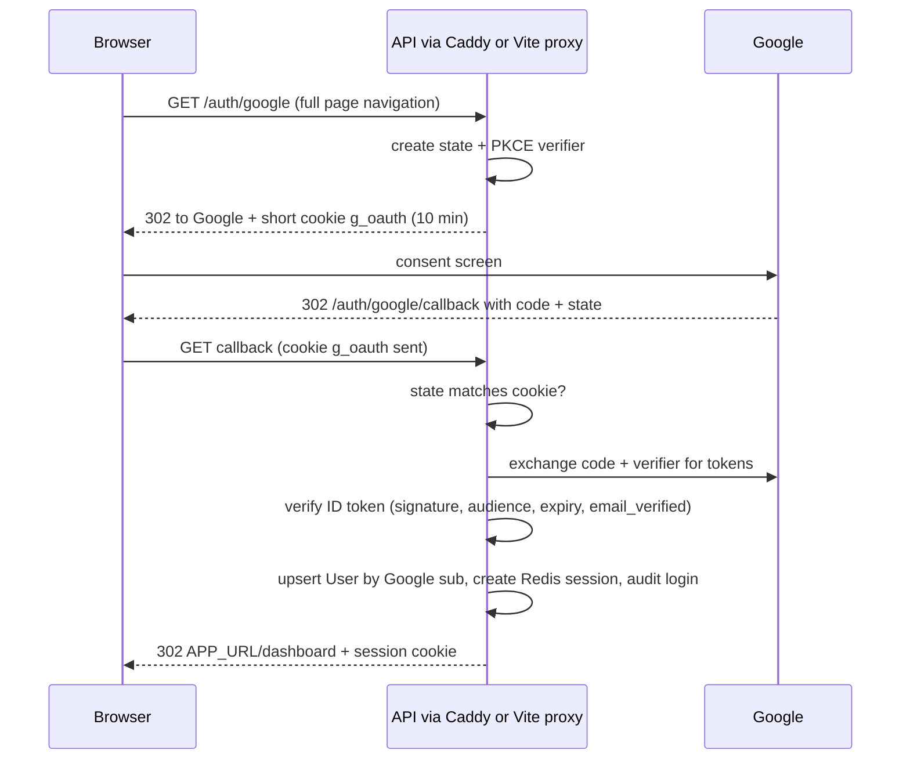

# 06 · Auth (Google), sessions and Slack

## Hosting: one origin

| Setup | Example | Login cookie | Needs | Status |
|---|---|---|---|---|
| **1. One origin** | `rottom.outbox.shikharsaxena.space` serves the frontend, and `/api`, `/auth`, `/admin` are forwarded to the private backend | ✅ first-party | Caddy (prod) / Vite proxy (local) | ✅ **chosen** |
| 2. Subdomains | `app.your-domain.com` + `api.your-domain.com` | ✅ same site | CORS with credentials + exact origin, `credentials: 'include'` | superseded |
| 3. Different sites | `myapp.vercel.app` + `myapi.onrender.com` | ⚠️ third-party cookie: **Safari blocks, Firefox isolates** | token in a header instead (more code, XSS risk) | rejected |

**Why we moved from 2 to 1:** the user didn't want a public `api.` hostname. With Caddy on one EC2, routing by path is *simpler* than two subdomains: no CORS setup, no `credentials: 'include'`, and the cookies are first-party.

Cookies are grouped by **site**, not by full domain. Hosting suffixes like `vercel.app` count as their own top-level suffix, so two `*.vercel.app` apps are different sites. That's why setup 3 breaks.

**What's public:**
```
Internet ──443 (HTTPS)──▶ Caddy ──plain HTTP──▶ api:4000            (private)
                                                  │
                                    postgres · redis · elasticsearch  (private)
                     workers: no inbound connections at all
```
| Piece | Reachable from the internet? |
|---|---|
| Caddy :443 | ✅ the only public entry |
| Express :4000 | ❌ private Docker network only |
| Workers | ❌ nothing listens |
| Postgres / Redis / ES | ❌ never |

The browser still has to reach `/api` and `/auth`: the React app runs on the user's machine, and Google and Slack redirect the browser to our callbacks. That entry must be HTTPS because:
- **Slack** rejects non-HTTPS redirect URLs.
- **Google** requires HTTPS for any redirect URI other than localhost.
- **Cookies:** `Secure` / `__Host-` cookies are only sent over HTTPS.
- **Without HTTPS,** cookies would travel in plain text.

HTTPS doesn't expose anything extra; it encrypts what's already reachable. Full deployment details: [11](./11-deployment-aws.md).

**Wiring:**
- The frontend calls **relative** URLs (`fetch('/api/...')`). Same origin, so the cookie is sent automatically and there's no CORS middleware.
- **Origin check (kept):** POST/PUT/DELETE must have `Origin === APP_URL` and JSON content. It's cheap protection against cross-site request forgery on top of `SameSite=Lax`.
- Every redirect is built from `APP_URL` / `SLACK_REDIRECT_URI` (env), **never from the `Host` header**. Behind a proxy, that header can hold the internal address.

## Why sessions at all

OAuth covers **one moment**: login. Google confirms "this is prithvi@gmail.com" and steps out. On every request after that, **our app** has to remember the user. That's the session.

```
LOGIN (once):    Browser ⇄ Google → ID token (valid ~1 hour) → API verifies → creates OUR session → cookie
EVERY REQUEST:   Browser → API (cookie) → Redis sess:<id> → userId        (Google no longer involved)
```

Using Google's token as the session doesn't work: it **expires after about 1 hour** (keeping you logged in would mean storing Google refresh tokens, which are sensitive), and **logout can't kill it**.

| Option | Logout really ends it | Survives restart | Several API servers | Cleanup of old sessions | Cost per request |
|---|---|---|---|---|---|
| Google's token | ❌ | ✅ | ✅ | none | verify signature |
| Our own JWT cookie | ❌ (until expiry, unless a blocklist, which needs Redis anyway) | ✅ | ✅ | none | ~0 |
| **Redis session** ✅ | ✅ instant (delete the key) | ✅ AOF | ✅ | **automatic** (TTL expiry) | 1 Redis read (<1ms) |
| Postgres session table | ✅ | ✅ | ✅ | expired rows need deleting, which means a **scheduled job** (breaks no-cron) | 1 DB query |
| In-memory | ✅ | ❌ | ❌ | automatic | ~0 |

## What's in the cookies

| Name (https / plain http) | Value | Path | Lifetime | Flags |
|---|---|---|---|---|
| `__Host-sid` / `sid` | **only a random 256-bit ID** (43 chars). No name, email, user ID or tokens | `/` | 7 days | HttpOnly, Secure (https), SameSite=Lax |
| `__Host-g_oauth` / `g_oauth` | `{ state, codeVerifier }` during Google login | `/` | ≤ 10 min, **deleted in the callback** | HttpOnly, Secure (https), SameSite=Lax |

- Nothing else lives in the browser: no Google tokens, no Slack data (Slack `state` is in Redis), nothing in `localStorage`. The frontend learns who you are only from `GET /api/me`.
- **`__Host-` prefix:** browsers only accept a `__Host-` cookie if it's `Secure`, has `Path=/` and has no `Domain`. Any other subdomain of your domain therefore can't plant a fake session or login cookie ("cookie tossing").
- On plain `http://localhost` the prefix and `Secure` are switched off automatically:

```ts
const https = env.APP_URL.startsWith('https://');
export const cookieName = (n: string) => (https ? `__Host-${n}` : n);
export const cookieOpts = { httpOnly: true, secure: https, sameSite: 'lax', path: '/' } as const;
```

## Google login

**Google Cloud Console (once):**
- OAuth client of type "Web application".
- Redirect URIs: `https://localhost:5173/auth/google/callback` (local, through the Vite proxy) and `https://rottom.outbox.shikharsaxena.space/auth/google/callback`.
- Consent screen: External, **Testing** mode, with you and the reviewers as **test users** (only test users can sign in while in testing mode). Add your domain to the authorized domains (exact requirements still to confirm).



```ts
const google = new OAuth2Client(env.GOOGLE_CLIENT_ID, env.GOOGLE_CLIENT_SECRET, `${env.APP_URL}/auth/google/callback`);
const OAUTH = cookieName('g_oauth');

router.get('/auth/google', async (_req, res) => {
  const state = crypto.randomBytes(32).toString('base64url');
  const { codeVerifier, codeChallenge } = await google.generateCodeVerifierAsync();
  res.cookie(OAUTH, JSON.stringify({ state, codeVerifier }), { ...cookieOpts, maxAge: 600_000 });
  res.redirect(google.generateAuthUrl({
    scope: ['openid', 'email', 'profile'], state, prompt: 'select_account',
    code_challenge: codeChallenge, code_challenge_method: CodeChallengeMethod.S256,
  }));
});

router.get('/auth/google/callback', async (req, res) => {
  const fail = (why: string) => res.redirect(`${env.APP_URL}/login?error=${why}`);
  const saved = JSON.parse(req.cookies[OAUTH] ?? 'null');
  res.clearCookie(OAUTH, cookieOpts);
  if (req.query.error) return fail('cancelled');
  if (!saved || req.query.state !== saved.state) return fail('state');
  try {
    const { tokens } = await google.getToken({ code: String(req.query.code), codeVerifier: saved.codeVerifier });
    const p = (await google.verifyIdToken({ idToken: tokens.id_token!, audience: env.GOOGLE_CLIENT_ID })).getPayload()!;
    if (!p.email_verified) return fail('unverified');
    const user = await prisma.user.upsert({
      where:  { googleId: p.sub },
      create: { googleId: p.sub, email: p.email!, name: p.name ?? p.email!, avatarUrl: p.picture },
      update: { email: p.email!, name: p.name ?? p.email!, avatarUrl: p.picture },
    });
    await createSession(res, user.id);
    await audit({ userId: user.id, type: 'login', actor: `user:${user.id}` });
    res.redirect(`${env.APP_URL}/dashboard`);
  } catch { fail('google'); }
});
```

**Sessions (Redis):**
```ts
const TTL = 7 * 24 * 3600;
const SID = cookieName('sid');
export async function createSession(res, userId: string) {
  const sid = crypto.randomBytes(32).toString('base64url');
  await redis.set(`sess:${sid}`, userId, 'EX', TTL);
  res.cookie(SID, sid, { ...cookieOpts, maxAge: TTL * 1000 });
}
export const requireAuth = async (req, res, next) => {
  const userId = req.cookies[SID] && await redis.get(`sess:${req.cookies[SID]}`);
  if (!userId) return res.status(401).json({ error: 'unauthenticated' });
  req.userId = userId; next();
};
// POST /auth/logout → redis.del(`sess:${sid}`), clearCookie(SID), audit 'logout'
// GET  /api/me      → { name, email, avatarUrl }
```

- Only `openid email profile` is requested. **Google tokens are not stored.**
- **Frontend:** the button does `window.location.href = '/auth/google'` (a fetch can't follow OAuth redirects). `useMe()` calls `/api/me`, and a 401 goes to `/login`. The avatar uses `referrerPolicy="no-referrer"`, with initials as the fallback. `/login?error=…` shows a toast.
- There's no `?next=` parameter: login always lands on `/dashboard`, so it can't be used to redirect users elsewhere.

## Slack connect

**Slack app (once, at api.slack.com/apps):**
- Create "ReachInbox Alerts" and turn on **Incoming Webhooks**.
- Redirect URLs (must be HTTPS): `https://localhost:5173/api/slack/callback` (local) and `https://rottom.outbox.shikharsaxena.space/api/slack/callback`.
- Scope: `incoming-webhook`.
- **Manage Distribution:** turn on only if people outside your workspace will connect.
- `SLACK_REDIRECT_URI` (env) holds the URL for the current environment. It's used in **both** the authorize link and `oauth.v2.access`, which must match.

**What the user sees:** "Connect Slack" → Slack page (pick workspace + **channel**) → Allow → back on the dashboard with a "Slack connected" toast and a ✅ test message in the channel → the button reads "✓ #email-alerts · Acme" with a Disconnect option.


```ts
router.get('/api/slack/connect', requireAuth, async (req, res) => {
  const state = crypto.randomBytes(32).toString('base64url');
  await redis.set(`slack_state:${state}`, req.userId, 'EX', 600);
  res.redirect('https://slack.com/oauth/v2/authorize?' + new URLSearchParams({
    client_id: env.SLACK_CLIENT_ID, scope: 'incoming-webhook', state, redirect_uri: env.SLACK_REDIRECT_URI,
  }));
});

router.get('/api/slack/callback', requireAuth, async (req, res) => {
  const back = (s: string) => res.redirect(`${env.APP_URL}/dashboard?slack=${s}`);
  const owner = await redis.getdel(`slack_state:${req.query.state}`);
  if (req.query.error) return back('cancelled');                 // user clicked Cancel
  if (!owner || owner !== req.userId) return back('error');      // forged / expired / someone else's
  const r = await fetch('https://slack.com/api/oauth.v2.access', { method: 'POST', body: new URLSearchParams({
    client_id: env.SLACK_CLIENT_ID, client_secret: env.SLACK_CLIENT_SECRET,
    code: String(req.query.code), redirect_uri: env.SLACK_REDIRECT_URI,
  }) }).then(r => r.json());
  if (!r.ok) return back('error');
  // upsert SlackIntegration: webhookUrlEnc = encrypt(r.incoming_webhook.url), accessTokenEnc = encrypt(r.access_token),
  // channel, channelId, teamId, teamName, status 'active'
  // audit 'slack_connected'; notifications.add('slack', { userId, kind: 'connected' })
  back('connected');
});
// GET /api/slack    → { status, team, channel }   (never the webhook URL)
// DELETE /api/slack → auth.revoke (best effort), delete row, audit 'slack_disconnected'
```

**Why `state` is single use and tied to the user:** Slack's docs say to treat a `state` mismatch as a forgery. Tying it to the logged-in user also stops an attacker from tricking you into attaching *your* Slack channel to *their* account.

## Local dev and Slack

**Now: mkcert, on Vite only.** Only the browser-facing server needs HTTPS. Vite forwards to Express over plain HTTP, the same way Caddy does in production.

```powershell
choco install mkcert        # or: scoop install mkcert, or the .exe from GitHub releases
mkcert -install             # trust the local certificate authority (one time)
mkcert localhost            # → localhost.pem + localhost-key.pem  (git-ignored: *.pem)
```
```ts
// vite.config.ts
server: {
  port: 5173,
  https: { key: fs.readFileSync('../localhost-key.pem'), cert: fs.readFileSync('../localhost.pem') },
  proxy: { '/api': 'http://localhost:4000', '/auth': 'http://localhost:4000', '/admin': 'http://localhost:4000' },
}
```
- Local env: `APP_URL=https://localhost:5173`, `SLACK_REDIRECT_URI=https://localhost:5173/api/slack/callback`.
- **Never share `rootCA-key.pem`** (the authority's private key that mkcert creates). Anyone holding it could fake HTTPS sites on your machine.
- **Test alerts without OAuth:** Slack app → Incoming Webhooks → "Add New Webhook to Workspace", then `npm run dev:slack-webhook <url>` (dev-only script) saves it for your user. Sending the alert is an outgoing call, so it works from localhost with nothing else.

**If Slack's settings refuse `localhost`, or later for a proper setup:**
| Fix | How | Trade-off |
|---|---|---|
| HTTPS relay page | A public GitHub Pages repo whose page runs `location.replace('https://localhost:5173/api/slack/callback' + location.search)`. Register that page as the Slack redirect and in `SLACK_REDIRECT_URI` | 5 min, free, no DNS. The "public HTTPS intermediate" pattern. Safe: the page only forwards to localhost, and the `code` is single-use and needs our client secret |
| `local.your-domain.com` with a real certificate | **New** GoDaddy A record → `127.0.0.1` + a Let's Encrypt certificate via one manual TXT record (`certbot/certbot` in Docker; on Windows use the `archive/` files) | Uses your domain, nothing exposed, 90-day manual renewal |
| ngrok static domain | `ngrok http --url=something.ngrok-free.app 5173` | No local HTTPS. One-time warning page. Local app reachable while it runs |

**Not chosen:** moving the domain's DNS to Cloudflare (for a Cloudflare Tunnel). The domain already hosts a portfolio and another project, and one missed record would break them. We only ever **add new** records.

## Alert delivery

```
limit reached (atomic counter: count == limit)  →  notifications job (jobId slack-<user>-<sender|global>-<window>)
  → read SlackIntegration NOW (no cache)
      none / broken → audit slack_skipped (no crash)
      active        → POST webhook
         ok                                                    → audit slack_notified
         permanent (no_service, no_active_hooks, invalid_token,
           channel_not_found, channel_is_archived, team_disabled,
           no_team, action_prohibited)                         → mark broken + lastError, audit, no retry
         429 / 5xx / timeout                                   → retry with backoff
```

- Errors are classified by **Slack's error string**, not the HTTP status. Slack documents the strings but not a clear status code for each.
- **Disconnect:** the alert skips quietly.
- **Removed on Slack's side:** the next alert gets a permanent error, so the integration is marked broken and the UI shows "Reconnect Slack".
- **Reconnect:** the same flow, and the upsert replaces the webhook. It works immediately because the worker reads the DB on every alert.

## Slack messages

| When | Message |
|---|---|
| Right after connecting | ✅ *ReachInbox connected.* Rate-limit alerts for your senders will appear in #email-alerts. |
| Per-sender mode: a sender reaches its limit | the alert below, once per sender per window |
| Global mode: the system limit is reached | ⚠️ *System limit reached* (200 per hour across all senders). Queue paused until 15:00. Sent once per window, to the owner of the email that reached it |

```json
{
  "text": "⚠️ Limit reached for alice@ethereal.email (200 per hour). Sending resumes at 15:00 UTC.",
  "blocks": [
    { "type": "header", "text": { "type": "plain_text", "text": "⚠️ Sender limit reached" } },
    { "type": "section", "fields": [
      { "type": "mrkdwn", "text": "*Sender*\nalice@ethereal.email" },
      { "type": "mrkdwn", "text": "*Limit*\n200 per hour" },
      { "type": "mrkdwn", "text": "*Still queued*\n37 emails" },
      { "type": "mrkdwn", "text": "*Resumes*\n<!date^1730556000^{time}|15:00 UTC>" } ] },
    { "type": "context", "elements": [ { "type": "mrkdwn",
      "text": "Campaign: Q4 pricing outreach · per-sender mode · <https://rottom.outbox.shikharsaxena.space/dashboard|Open dashboard>" } ] }
  ]
}
```

- **`text`:** the plain fallback, used in phone notifications.
- **"Still queued":** that sender's emails still waiting, counted when the alert is sent (in global mode: only the user's own, never other users' numbers).
- **The window is named as configured:** "200 per hour" in production, "5 per minute" with the 60s demo window.
- **`<!date^…>`:** shows each reader's own timezone.
- **Dashboard link:** a plain text link, not a button (a button would need Slack's interactivity settings).
- **Escaping:** `&`, `<` and `>` are escaped in user text, so a subject like `<!channel>` can't ping everyone.
- **Skipped:** "limit cleared" (needs a timer), daily summaries (needs cron), "campaign finished".

## Why not "Sign in with Slack"

| | Scopes | Gives |
|---|---|---|
| Sign in with Slack | `openid email profile` | who you are |
| Our Connect Slack | `incoming-webhook` | permission to post into a channel |

The assignment requires Google login, and posting needs `incoming-webhook` either way. Neither provider replaces our own session.

## Why not send from the user's Gmail

Login asks for no mail permission. Sending through Gmail needs the `gmail.send` scope: it's sensitive (Google app verification is required), and Gmail has its own daily limits. The assignment says to use Ethereal. Senders are a table, so a "Gmail sender" type could be added later.

## Security checklist

- [ ] Google: `state` + PKCE S256, ID token verified, `email_verified` required, user keyed by `sub`
- [ ] Sessions: random 256-bit ID, Redis TTL 7d, `__Host-` + `HttpOnly; Secure; SameSite=Lax; Path=/` on https, logout deletes the key
- [ ] Slack `state`: random, single use (`GETDEL`), 10 min, must match the session user
- [ ] Webhook URL, Slack token and Ethereal passwords encrypted (AES-256-GCM, `node:crypto`, `ENCRYPTION_KEY`), never returned or logged
- [ ] One origin, no CORS. `Origin` check on writes, plus `SameSite=Lax` cookies
- [ ] Only Caddy :443 public. Express, workers and databases private ([11](./11-deployment-aws.md))
- [ ] Redirects built from env, no `?next=`
- [ ] Every query filtered by `userId` from the session (including the second check in ES search)
- [ ] User text escaped in Slack messages
- [ ] Bull Board read-only, admins only (`ADMIN_EMAILS`)
- [ ] Per-user cap on waiting emails (`MAX_PENDING_EMAILS_PER_USER`)
- [ ] `.env`, `*.pem`, `certs/` git-ignored. Only `.env.example` committed
